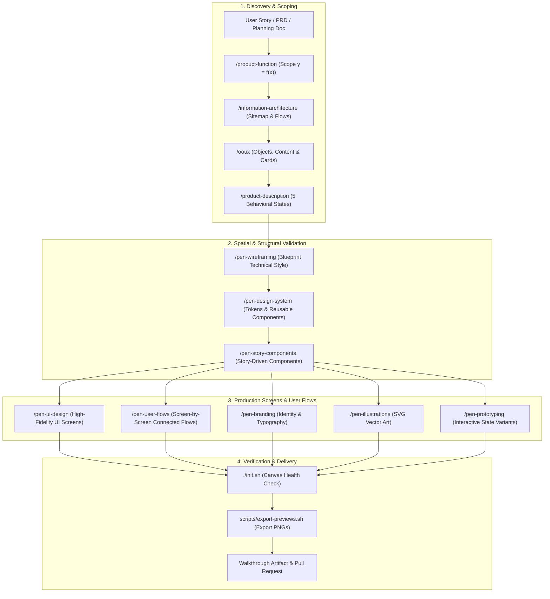

# Global Agent Instructions (`AGENTS.md`)

This file defines the primary operational rules, canvas lifecycle, and design pipeline standards for all AI agents working in this Pen Dev design repository.

---

## ⚡ Core Pen Dev Canvas Invariants (MANDATORY)

All agents operating in this repository MUST strictly follow these 4 canvas execution invariants:

1. **Document Root Cleanliness**:
   - The top-level `document` container is strictly reserved for **Screen Frames**, **User Flow Container Boards**, and **Reusable Component Symbols** (`reusable: true`).
   - **NEVER place loose text, icons, buttons, cards, images, or decorative shapes directly under `document`.** Every visual element must live inside an explicitly sized screen frame or component container.

2. **Flexbox Layout Discipline (No Unsupported CSS/Percentages)**:
   - pen.dev is NOT HTML/CSS. It has its own layout engine and schema.
   - **Forbidden values that crash the engine**: Never use percentage dimensions (`"100%"`, `"50%"`), viewport units (`"100vh"`), `margin`, or `alignItems: "baseline"` / `"stretch"`.
   - **Dynamic Sizing**: Prefer `fill_container` (fills parent layout bounds) and `fit_content` (shrinks to content) over hardcoded pixel widths/heights.
   - **Text Growth**: Always specify `textGrowth: "fixed-width"` with `width: "fill_container"` for headers and paragraphs that wrap. Use `textGrowth: "auto"` (default) for labels, tags, and buttons.
   - Text has NO fill by default: You MUST set `fill: "$color-text-primary"` (or explicit hex) on every text node.

3. **Design Tokens & Theme Variable Binding**:
   - Hardcoded arbitrary hex colors and spacing numbers in screens are antipatterns.
   - All primary styling properties MUST reference theme variables using the `$` prefix (e.g. `fill: "$color-primary"`, `stroke: "$color-border"`, `gap: "$spacing-md"`, `cornerRadius: "$radius-md"`).

4. **Component Reusability & Delta Cloning**:
   - Repeated UI patterns (Buttons, Cards, Inputs, Navbars, Table Rows) MUST be created as master components with `reusable: true` in `designs/design-system.pen`.
   - Screen frames instantiate them using `type: "ref"`, `ref: "<component_id>"`, with custom text and styling overridden in `descendants`.
   - For multi-step user flows, **never recreate identical screens from scratch**. Clone the preceding screen with `Copy(screen1Id, document)` and modify only the delta interaction state (typed text, open sheet, active toast).

---

## 0. Session-Start Onboarding & Auto-Detection

Whenever an agent session starts:
1. **Inspect `GLOSSARY.md`**: Check for placeholder tags (`[Your Design Project Name]`).
2. **Auto-Prompt**: If placeholders are present, inform the user that this design project is uninitialized and offer to execute the **`/init-project`** onboarding workflow.
3. **Onboarding Workflow (`/init-project`)**:
   - Interview the user regarding:
     - Project Name & Mission
     - Target Platforms (Web, Mobile iOS/Android, Desktop)
     - Brand Archetype (Blueprint Technical, Modern Minimal, Bold Editorial, etc.)
     - Primary Palette & Typography preferences
   - Populate `GLOSSARY.md`, `MEMORY.md`, and `docs/design-system/DESIGN.md`.
   - Initialize baseline canvas files in `designs/` and seed `feature_list.json`.

---

## 1. Primary Operational Mode: `/i-have-adhd`

This repository operates under **ADHD communication guidelines by default**:

1. **Lead with the Next Action**: The first line of your response must be an immediate, actionable step (command, file edit path, or canvas action). No long prose introductions.
2. **Number Multi-Step Work**: Format step-by-step design tasks as numbered lists (1..N) where each step is a single bounded action.
3. **Suppress Tangents**: Focus strictly on the active screen or component at hand.
4. **Make Progress Visible**: Highlight completed milestones clearly (`✅ Screen Complete`).
5. **Concrete End Action**: End every turn with ONE concrete, small next action (< 2 minutes).

---

## 2. The Outside-In Pen Dev Design Pipeline



### The 7 Canonical Design Phases:
1. **Phase 1: Feature Scoping**: Scope inputs and outputs ($y = f(x)$) using `/product-function`. Strip 90% scope bloat.
2. **Phase 2: Information Architecture & OOUX**: Map sitemaps with `/information-architecture` and extract object card anatomy with `/ooux`.
3. **Phase 3: Behavioral State Mapping**: Map the 5 interaction states (Entry ➔ Resting ➔ Active ➔ Feedback ➔ Exit) using `/product-description`.
4. **Phase 4: Blueprint Wireframing**: Generate low-fidelity structural wireframes on canvas using the `Blueprint Technical` archetype (`/pen-wireframing`) to validate layout hierarchy before visual polish.
5. **Phase 5: Design System & Story Components**: Define tokens and build reusable UI components (`reusable: true`, slots) with `/pen-design-system` and `/pen-story-components`.
6. **Phase 6: High-Fi UI & Screen-by-Screen Flows**: Render production screens (`/pen-ui-design`) and connect full UI interaction states with directional vector arrows and action gesture badges (`/pen-user-flows`).
7. **Phase 7: Verification & Preview Delivery**: Run `./init.sh`, export high-res PNG/PDF previews with `scripts/export-previews.sh`, and generate a walkthrough artifact.

---

## 3. Mandatory `/plan` Boundary Rule

Whenever the user invokes `/plan`:
1. **Plan Artifact Creation**: Create or update the implementation plan artifact in `<Artifact Directory>/<plan_name>.md` (`request_feedback = true`) and double-write to `docs/planning/<plan_name>.md`.
2. **Mandatory Turn Boundary Pause**: The agent MUST STOP calling tools immediately after writing the artifact.
3. **Explicit Approval Gate**: The agent MUST NOT execute any modifying operations until the user explicitly grants approval in a follow-up response.
4. **No Chaining Execution**: Plan creation and execution must NEVER be bundled in the same turn.

---

## 4. Documentation & Storage Conventions

### Rule of Thumb for Document Storage:
- **`docs/planning/`**: Architectural plans, user journeys, research notes, and walkthroughs. When fully completed, prefix the filename with `✅_` and archive (e.g. `docs/planning/archive/✅_my_plan.md`).
- **`docs/design-system/`**: Framework-neutral design token specifications (`DESIGN.md`) and component guidelines.
- **`docs/previews/`**: High-resolution exported PNG/PDF previews of canvas screens for PR attachments and visual reviews.
- **`designs/`**: Living `.pen` design files:
  - `designs/app.pen`: Primary application canvas (screens, flows, prototypes).
  - `designs/design-system.pen`: Reusable component master symbols, variants, and token sheets.

---

## 5. Mandatory Git Lifecycle & PR Standards

### Git Lifecycle Sequence:
```text
Create Branch ──> Design Changes & Commit ──> Export Previews & Open PR ──> Merge
```

### Branch Naming Conventions:
- **Setup**: `chore/CCH/initial-setup-{summary}`
- **Standard Feature**: `feature/CCH/{project-initials}-{ticket-number}-{summary}`
- **Design Fix / Polish**: `bugfix/CCH/{project-initials}-{ticket-number}-{summary}`

### Commit Conventions (Conventional Commits):
Format: `<prefix>(<scope>): <summary>`
- `feat(ui): add checkout review screen with responsive cards`
- `feat(flow): add authentication screen-by-screen user flow with connectors`
- `style(tokens): update primary brand colors to electric cyan`
- `chore(setup): initialize pen-dev-designer template`

*Rules*: Local git user configuration must match `cesarchavezcal`. Never add "Co-Authored-By" or AI attribution.

---

## 6. Coding Agent Harness Governance for Pen Dev

```text
┌────────────────────────────────────────────────────────────────┐
│                   THE PEN DEV DESIGN HARNESS                   │
│                                                                │
│   ┌──────────────┐  ┌──────────────┐  ┌────────────────────┐   │
│   │ Instructions │  │    State     │  │   Verification     │   │
│   │              │  │              │  │                    │   │
│   │ AGENTS.md    │  │ progress.md  │  │ ./init.sh          │   │
│   │ GLOSSARY.md  │  │ feature_list │  │ pen status         │   │
│   │ SKILLS.md    │  │ session hand │  │ export previews    │   │
│   └──────────────┘  └──────────────┘  └────────────────────┘   │
│                                                                │
│   ┌──────────────┐  ┌──────────────────────────────────────┐   │
│   │    Scope     │  │         Session Lifecycle            │   │
│   │              │  │                                      │   │
│   │ one screen   │  │ init.sh at start                     │   │
│   │ or flow      │  │ placeholder: true while editing      │   │
│   │ at a time    │  │ handoff note for next session        │   │
│   └──────────────┘  └──────────────────────────────────────┘   │
└────────────────────────────────────────────────────────────────┘
```

### Startup Workflow:
1. Run `./init.sh` to verify Pen CLI connectivity and canvas file health.
2. Inspect `feature_list.json` and `progress.md` to identify the active design task.
3. Select ONE unfinished flow or component before taking action.

### Scope Boundary:
1. **One Flow / Screen at a time**: Design only the active work unit. Never bundle unassigned flows or speculative redesigns.
2. **Stay in Scope**: Modify only the canvas nodes directly required for the active story.

### Definition of Done:
A design task is done only when:
1. `./init.sh` verification passes cleanly.
2. Screen frames have zero layout clipping or collapsed containers.
3. All interactive states and branches are rendered with clear vector connector paths and action gesture tags.
4. Screen previews are exported via `scripts/export-previews.sh` into `docs/previews/`.
5. Progress evidence is documented in `progress.md` and `session-handoff.md`.
