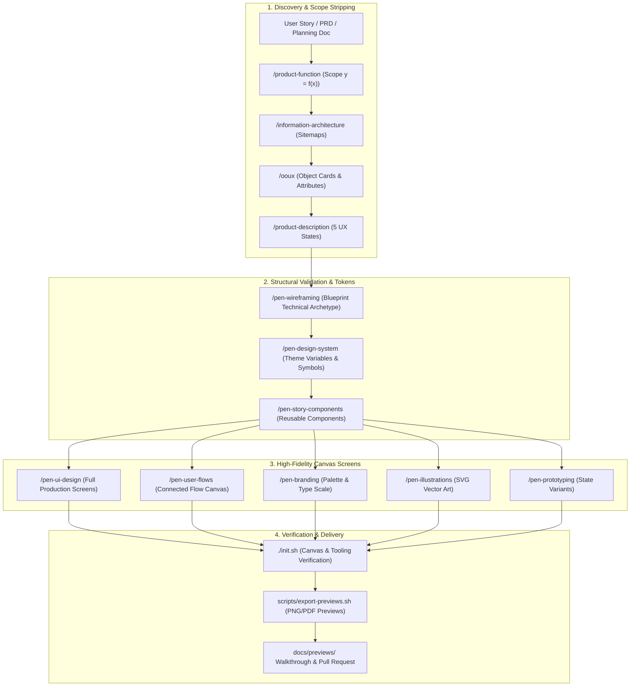

# 🎨 Pen Dev Design Agent Boilerplate (`pen-dev-designer`)

[](https://github.com/cesarchavezcal/pen-dev-designer)
[](https://pen.dev)
[](#)
[](https://opensource.org/licenses/MIT)

> **A battle-tested GitHub Template Repository designed for autonomous AI agents creating digital product designs, design systems, blueprint wireframes, and screen-by-screen user flows on the [Pen Dev (`pen.dev`)](https://pen.dev) infinite canvas.**

---

## 🌟 What This Boilerplate Enables in Pen Dev

This boilerplate replaces traditional code-engineering scaffolding with native infinite-canvas design governance and automation. It empowers your AI agent to deliver:

1. **Production UI Design (`/pen-ui-design`)**: High-fidelity web, mobile, and desktop screens with dynamic flexbox layout (`fill_container`, `fit_content`).
2. **Screen-by-Screen User Flows (`/pen-user-flows`)**: Renders full UI screens for each interaction step, connected by vector arrows, action gesture chips (`🏷️ [TAP]`, `🏷️ [TYPE]`), and decision branches.
3. **Blueprint Wireframes (`/pen-wireframing`)**: Rapid structural layouts using the built-in `Blueprint Technical` archetype before committing to high-fidelity visual styling.
4. **Interactive Prototypes (`/pen-prototyping`)**: Component state variants (hover, active, disabled, sheet open, modal overlay, error toast) and transitions.
5. **Design Systems & Theme Variables (`/pen-design-system`)**: Color palettes, typography scales, spacing tokens, and `reusable: true` component symbols with slot frames.
6. **Story-Driven Feature Components (`/pen-story-components`)**: Converts agile user story acceptance criteria into isolated reusable UI cards and widgets.
7. **Progressive Interaction Flows (`/pen-screen-by-screen`)**: Follows planning docs screen-by-screen, delta-cloning preceding states (`Copy()`) to ensure zero visual drift.
8. **Branding Identities (`/pen-branding`)**: Color harmonies, font pairings, moodboards, and vector logo marks on canvas.
9. **SVG Vector Illustrations (`/pen-illustrations`)**: Bespoke vector artwork and decorative illustrations generated natively on canvas via `Generate({ type: "svg" })`.

---

## 🚀 One-Prompt Creation & Quickstart

### 1. Create a Repository from this Template
To start a new design project using this template, run:

```bash
gh repo create my-app-designs --template cesarchavezcal/pen-dev-designer --public --clone
cd my-app-designs
```

### 2. Auto-Detect Onboarding
Open the project in your AI coding assistant (Google Antigravity, Claude Code, Cursor, Windsurf) and prompt:

> *"Execute `/init-project` to configure this design project."*

The agent will automatically:
1. Interview your project concept, target platforms (Web, Mobile iOS/Android, Desktop), and brand style.
2. Populate `GLOSSARY.md`, `MEMORY.md`, and `docs/design-system/DESIGN.md`.
3. Scaffold `designs/app.pen` and `designs/design-system.pen`.
4. Seed `feature_list.json` with foundational milestones.

---

## 🏗️ Architecture & Pipeline Flow



---

## 📁 Repository Structure

```text
pen-dev-designer/
├── .agents/
│   └── skills/                         # 35 workspace design, discovery & writing skills
├── .atl/
│   └── skill-registry.md               # Unified skill registry
├── .github/
│   ├── PULL_REQUEST_TEMPLATE.md        # Design PR template with canvas preview attachments
│   └── ISSUE_TEMPLATE/                 # Design story & visual defect templates
├── .cursorrules                        # Cursor IDE agent instructions
├── AGENTS.md                           # Master Pen Dev canvas rules & agent governance
├── CLAUDE.md                           # Claude Code entry point
├── GLOSSARY.md                         # Ubiquitous domain & canvas terminology
├── MEMORY.md                           # Durable brand decisions & design choices
├── SKILLS.md                           # Human-facing design skills catalog
├── feature_list.json                   # Agile design backlog (flows, screens, components)
├── init.sh                             # Design environment & canvas verification script
├── progress.md                         # Real-time session progress log
├── session-handoff.md                  # Restartable multi-session state
├── designs/                            # Living .pen design files
│   ├── app.pen                         # Primary application canvas
│   └── design-system.pen               # Reusable component library & variables
├── docs/
│   ├── planning/                       # Architecture plans (✅_ prefix when completed)
│   ├── design-system/                  # Design token specifications (DESIGN.md)
│   └── previews/                       # Exported PNG/PDF previews for PR walkthroughs
└── scripts/
    ├── setup-project.sh                # Interactive project initialization wizard
    └── export-previews.sh              # Canvas screen preview exporter
```

---

## ⚡ Canvas Governance & Execution Invariants

All agents operating in this repository must adhere to the 4 strict invariants in Section 6 of [`AGENTS.md`](./AGENTS.md):

1. **Document Root Cleanliness**: Only screen frames, flow container boards, and reusable components belong under `document`. No loose text or shapes.
2. **Flexbox Layout Discipline**: Pure dynamic sizing (`fill_container`, `fit_content`). Zero unsupported CSS (no percentage dimensions, no margin, no `alignItems: stretch`).
3. **Theme Variable Binding**: All primary fills, strokes, and spacing use `$`-prefixed tokens (`$color-primary`, `$spacing-md`).
4. **Delta Updates via `Copy()`**: Multi-screen user flows clone preceding screens and apply delta updates to eliminate visual drift.

---

## 🛠️ Verification & Tooling

To verify the local design environment and canvas integrity:
```bash
./init.sh
```

To export high-resolution preview images of all canvas screens:
```bash
bash scripts/export-previews.sh
```

---

## 📄 License
MIT © César Chávez ([@cesarchavezcal](https://github.com/cesarchavezcal))
