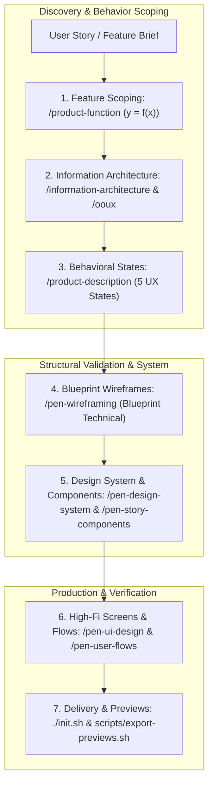

# Pen Dev Design Boilerplate: Architecture & Execution Lifecycle

## Goal Description

This document defines the architecture, workflow stages, canvas execution invariants, and operational harness governance of the **Pen Dev Design Agent Boilerplate (`pen-dev-designer`)**. It provides the complete reference map for how an agent and designer collaborate inside this repository to produce digital product designs on the [Pen Dev (`pen.dev`)](https://pen.dev) infinite canvas.

---

## 1. Core Paradigm: The Design Harness

Unlike traditional software engineering templates that scaffold build tools and application runtimes (Next.js, Vite, npm), this boilerplate functions as a **Design Agent Harness**. Code execution is replaced by canvas governance and vector design verification.

```
┌────────────────────────────────────────────────────────────────┐
│                   THE PEN DEV DESIGN HARNESS                   │
│                                                                │
│   ┌──────────────┐  ┌──────────────┐  ┌────────────────────┐   │
│   │ Instructions │  │    State     │  │   Verification     │   │
│   │              │  │              │  │                    │   │
│   │ AGENTS.md    │  │ progress.md  │  │ ./init.sh          │   │
│   │ GLOSSARY.md  │  │ feature_list │  │ pen status         │   │
│   │ SKILLS.md    │  │ session hand │  │ export previews    │   │
│   └──────────────┘  └──────────────┘  └────────────────────┘   │
│                                                                │
│   ┌──────────────┐  ┌──────────────────────────────────────┐   │
│   │    Scope     │  │         Session Lifecycle            │   │
│   │              │  │                                      │   │
│   │ one screen   │  │ init.sh at start                     │   │
│   │ or flow      │  │ placeholder: true while editing      │   │
│   │ at a time    │  │ handoff note for next session        │   │
│   └──────────────┘  └──────────────────────────────────────┘   │
└────────────────────────────────────────────────────────────────┘
```

The harness consists of 4 foundational pillars:
1. **Instructions (`AGENTS.md`, `SKILLS.md`, `GLOSSARY.md`)**: Strict canvas constraints, ubiquitous domain language, and 35 specialized design skills.
2. **State Tracking (`feature_list.json`, `progress.md`, `session-handoff.md`)**: Structured backlog of flows, real-time session progress, and context persistence across sessions.
3. **Verification (`./init.sh`, `scripts/export-previews.sh`)**: Automated health checks ensuring `.pen` files are intact, CLI tooling is connected, and visual PNG previews are exported.
4. **Scope Governance**: Strict boundary enforcement to design exactly one screen or flow at a time.

---

## 2. The 7-Phase Outside-In Design Pipeline

Every design feature progresses through a 7-phase outside-in pipeline that eliminates scope creep, validates spatial geometry, and delivers high-fidelity assets:



### Phase Breakdown:
1. **Phase 1: Feature Scoping (`/product-function`)**: Models the feature as a mathematical function ($y = f(x)$), defining the exact trigger situation ($x$) and desired outcome ($y$), stripping away 90% of speculative scope bloat.
2. **Phase 2: Information Architecture & OOUX (`/information-architecture`, `/ooux`)**: Maps sitemaps and extracts core objects, nested relationships, and object card metadata.
3. **Phase 3: Behavioral State Mapping (`/product-description`)**: Models the 5 user experience states (*Entry ➔ Resting ➔ Active ➔ Feedback ➔ Exit*) and accounts for edge-case interrupts before touching visual styling.
4. **Phase 4: Blueprint Wireframing (`/pen-wireframing`)**: Drafts low-fidelity structural artboards using the `Blueprint Technical` archetype on canvas to validate spatial density and layout hierarchy.
5. **Phase 5: Design System & Tokens (`/pen-design-system`, `/pen-story-components`)**: Configures theme variables (`$color-*`, `$spacing-*`, `$radius-*`) and reusable components (`reusable: true`, slots) in `designs/design-system.pen`.
6. **Phase 6: High-Fidelity UI & Flows (`/pen-ui-design`, `/pen-user-flows`)**: Constructs pixel-perfect screens in `designs/app.pen` connected with directional vector arrows, interaction badges (`🏷️ [TAP]`, `🏷️ [TYPE]`), and conditional decision branches.
7. **Phase 7: Verification & Delivery (`./init.sh`, `scripts/export-previews.sh`)**: Runs harness verification, exports high-res PNG/PDF previews to `docs/previews/`, and creates a PR walkthrough.

---

## 3. Mandatory Pen Dev Canvas Invariants

All canvas operations must strictly comply with the 4 invariants defined in [`AGENTS.md`](file:///Users/cesaradalbertochavezcalderon/Personal/design-tester/AGENTS.md):

1. **Document Root Cleanliness**:
   - The top-level `document` container is strictly reserved for **Screen Frames**, **User Flow Container Boards**, and **Reusable Master Symbols** (`reusable: true`).
   - Loose text, raw icons, floating buttons, or decorative shapes are strictly forbidden directly under `document`.
2. **Flexbox Layout Discipline**:
   - No CSS unsupported values: never use percentage strings (`"100%"`), viewport units (`"100vh"`), `margin`, or `alignItems: "stretch"`.
   - Use dynamic flexbox sizing: `fill_container` to expand to parent bounds, `fit_content` to shrink to content.
   - Text elements must have explicit fills (e.g. `fill: "$color-text-primary"`) and `textGrowth: "fixed-width"` with `width: "fill_container"` for multiline text.
3. **Design Tokens & Theme Variable Binding**:
   - Never hardcode arbitrary hex colors or spacing values in screen frames. All styling must bind to `$`-prefixed tokens (`$color-primary`, `$spacing-md`, `$radius-md`).
4. **Component Reusability & Delta Cloning**:
   - UI elements are defined once in `designs/design-system.pen` and instantiated via `type: "ref"`.
   - Multi-screen flows must use `Copy(screenId, document)` to clone preceding screens, modifying only delta interaction states to avoid visual drift.

---

## 4. Operational Modes & Agent Protocol

1. **Default Mode: `/i-have-adhd`**:
   - Start replies with an immediate, actionable step.
   - Use numbered lists for multi-step work.
   - Suppress tangents; maintain focus on the single active flow.
   - End turns with one concrete action (< 2 minutes).
2. **Strict `/plan` Boundary Rule**:
   - When `/plan` is invoked, generate plan artifacts in `docs/planning/`, request feedback, and pause immediately at the turn boundary before any modifications.
3. **Git Lifecycle**:
   - Conventional commits (`feat(ui): ...`, `style(tokens): ...`).
   - Identity bound to `cesarchavezcal`.
   - Export preview assets to `docs/previews/` prior to PR creation.

---

## User Review Required

> [!IMPORTANT]
> The repository is currently in its uninitialized template state (placeholders present in `GLOSSARY.md`). To apply this process to a concrete project, we should run the initial onboarding workflow.

## Open Questions

1. **Project Initiation**: Would you like to proceed with the `/init-project` onboarding interview now to define your project's name, platform targets (Web, Mobile, Desktop), and brand archetype?
2. **Alternative Focus**: Or would you prefer to explore a specific phase (e.g. drafting design system tokens or inspecting canvas files) directly?

---

## Verification Plan

### Automated Verification
- Run `./init.sh` to check Pen CLI tooling and canvas file integrity:
  ```bash
  ./init.sh
  ```

### Manual Verification
- Verify that `designs/app.pen` and `designs/design-system.pen` exist and conform to the root cleanliness invariants.
