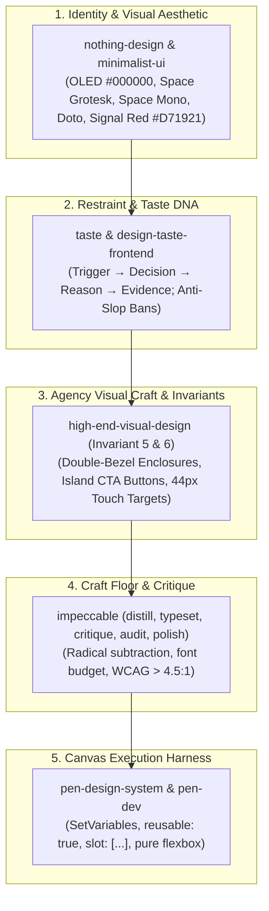

# Master Multi-Skill Implementation Plan: CraftUI Studio Design System (`feat-002`)

## Goal Description

Synthesize all newly pulled upstream template capabilities (44 specialized design intelligence skills, updated 6 Canvas Invariants in [`AGENTS.md`](file:///Users/cesaradalbertochavezcalderon/Personal/design-tester/AGENTS.md)) with the **`nothing-design`**, **`taste`**, **`high-end-visual-design`**, and **`impeccable`** frameworks to construct the definitive commercial component system in [`designs/design-system.pen`](file:///Users/cesaradalbertochavezcalderon/Personal/design-tester/designs/design-system.pen) and [`docs/design-system/DESIGN.md`](file:///Users/cesaradalbertochavezcalderon/Personal/design-tester/docs/design-system/DESIGN.md).

---

## 1. Architectural Skill Stack & Governance Matrix



---

## 2. The 6 Strict Canvas Invariants (`AGENTS.md`)

All component symbols in `designs/design-system.pen` must comply with the 6 mandatory invariants:

1. **Document Root Cleanliness**: Only screen frames and major matrix boards (`reusable: true`) live directly under `document`. Zero loose text, icons, or floating buttons.
2. **Flexbox Layout Discipline**: Pure dynamic sizing (`fill_container`, `fit_content`). Zero unsupported CSS (`margin`, percentages, viewport units, `alignItems: "stretch"` or `"baseline"`). Explicit fills on all text nodes.
3. **Theme Variable Binding**: All primary fills, strokes, and spacing bind to `$`-prefixed tokens (`$color-canvas`, `$color-accent`, `$spacing-md`, `$radius-lg`).
4. **Delta Updates via `Copy()`**: Multi-screen user flows clone preceding states and modify only interaction deltas.
5. **Agency-Tier Visual Craft (`high-end-visual-design`)**:
   - **Double-Bezel Hardware Enclosure**: An outer shell container (`fill: "rgba(255,255,255,0.03)"`, `padding: 6`, `cornerRadius: 24`, `stroke: "$color-border"`) enclosing an inner core surface (`cornerRadius: 18`).
   - **Nested Island CTA Buttons**: Pill or generous radius button with the trailing action icon enclosed in its own distinct circular frame wrapper.
   - **Spatial Rhythm**: Generous breathing room (`py: 64`–`120px` desktop, `py: 32`–`48px` mobile).
6. **Accessibility & Touch Target Standards (`ui-ux-pro-max`)**:
   - Minimum `44 x 44px` interactive touch targets for all mobile components with `8px` buffer.
   - Strict WCAG contrast ratio exceeding 4.5:1.

---

## 3. Taste DNA & Restraint Trade-Offs

Using the **`taste`** framework, every design decision is codified with explicit trade-offs rejecting AI tropes:

| # | Trigger | Decision | Reason | Evidence |
|---|---|---|---|---|
| **1** | Hero Metrics & Titles | Display numbers heroically large (`Doto` 36–72px or `Space Grotesk` 28px) floating directly on canvas background without nested cards | Nested boxes create visual noise and flatten hierarchy | Teenage Engineering & Braun industrial instrument panels |
| **2** | Color Strategy | Strict Monochrome canvas (OLED `#000000` / Technical Paper `#F5F5F5`); Signal Red (`#D71921`) reserved exclusively for active event CTAs | Color is an event, not a default; grayscale contrast IS hierarchy | Nothing Phone Glyph & hardware accents |
| **3** | Card Enclosures | Replace generic 1px gray cards with **Double-Bezel Hardware Enclosures** (outer subtle shell + inner high-contrast card) | Eliminates flat, template-looking card grids in favor of bespoke industrial hardware feel | High-End Agency Craft (`high-end-visual-design`) |
| **4** | Typography Budget | Exactly 2 font families (`Space Grotesk` + `Space Mono`), 3 sizes, and 2 weights per view; `Doto` for hero moments only | Strict font discipline prevents visual chaos | Swiss Typography & `impeccable:typeset` |
| **5** | Spatial Grouping | Spacing alone groups items before borders; borders group before cards (`impeccable:distill`) | Ruthless subtraction removes clutter | Dieter Rams: "Less, but better" |

---

## 4. Proposed Changes

### Component 1: Design Tokens Specification

#### [MODIFY] [`docs/design-system/DESIGN.md`](file:///Users/cesaradalbertochavezcalderon/Personal/design-tester/docs/design-system/DESIGN.md)
- Define Dual-Mode tokens:
  - **Dark Mode (OLED)**: `$color-canvas` (`#000000`), `$color-surface-1` (`#111111`), `$color-surface-2` (`#1A1A1A`), `$color-border` (`#222222`), `$color-border-visible` (`#333333`).
  - **Light Mode (Technical Paper)**: `$color-canvas-light` (`#F5F5F5`), `$color-surface-1-light` (`#FFFFFF`), `$color-surface-2-light` (`#EBEBEB`), `$color-border-light` (`#E0E0E0`).
  - **Accents**: `$color-accent` (`#D71921` Signal Red), `$color-accent-subtle` (`rgba(215,25,33,0.12)`), `$color-success` (`#4A9E5C`), `$color-warning` (`#D4A843`).
  - **Typography**: Display: `Doto`, Body/Headings: `Space Grotesk`, Data/Labels: `Space Mono` (ALL CAPS).

---

### Component 2: Canvas Component Matrix (`designs/design-system.pen`)

#### [MODIFY] [`designs/design-system.pen`](file:///Users/cesaradalbertochavezcalderon/Personal/design-tester/designs/design-system.pen)
Rebuild the 5 master matrix boards applying the Nothing aesthetic, Double-Bezel enclosures, and Island CTA buttons:

1. **Board 1: Theme Tokens & Instrument Panel Overview** (`x: 0, y: 0`)
   - Header with `Doto` dot-matrix title and `Space Mono` metadata tags.
   - Dual-mode color swatch matrix (OLED Black, Surface Grays, Signal Red `#D71921`).
   - Typographic scale demonstration (`Doto` 48px, `Space Grotesk` 24px, `Space Mono` 11px uppercase).

2. **Board 2: Buttons & Actions Matrix** (`x: 0, y: 340`)
   - **Island CTA Button (`reusable: true`)**: Outer pill container (`fill: "$color-accent"`, `padding: [8, 16, 8, 24]`) with inner circular icon chip (`fill: "rgba(0,0,0,0.2)"`, 28x28px, white trailing arrow).
   - **High-Contrast Secondary Button**: OLED dark `#FFFFFF` fill with `#000000` text.
   - **Wireframe Technical Button**: Hairline stroke `$color-border-visible`, fill `$color-surface-1`, text `$color-text-primary`.
   - **Monospace Action Badges**: `🏷️ [TAP]`, `🏷️ [TYPE]` in `Space Mono` ALL CAPS.

3. **Board 3: Form Elements & Technical Inputs** (`x: 0, y: 700`)
   - Text Inputs with `Space Mono` uppercase labels (`0.08em` tracking).
   - Search Input with keyboard shortcut chip (`⌘K`).
   - Custom toggle switch & radio controls adhering to 44px minimum touch targets.

4. **Board 4: Data Display & Double-Bezel Commercial Cards** (`x: 0, y: 1060`)
   - **Double-Bezel Metric KPI Card (`reusable: true`)**: Outer shell frame (`fill: "rgba(255,255,255,0.03)"`, `padding: 6`, `cornerRadius: 24`, `stroke: "$color-border"`) enclosing inner card (`cornerRadius: 18`, `fill: "$color-surface-1"`). Displays raw `Doto` 36px metric and green trend text.
   - **Double-Bezel Pricing Tier Card (`reusable: true`)**: Outer shell with Signal Red highlight, inner card with price, monospace feature checklist (`[✓]`), and Island CTA.
   - **Table Data Row (`reusable: true`)**: Monospace timestamps, avatar initial glyph, and status indicators.

5. **Board 5: Navigation Rail & Technical Overlays** (`x: 0, y: 1560`)
   - **Desktop Technical Rail (240px)**: Dot-matrix brand mark, uppercase monospace nav items with active indicator dot.
   - **Mobile TabBar (393x64px)**: OLED black bar with geometric stroke icons, active red dot signal, 44px touch targets.
   - **Modal Dialog & Technical Toast**: Hairline frame with uppercase status badges.

---

### Component 3: Project State Tracking

#### [MODIFY] [`feature_list.json`](file:///Users/cesaradalbertochavezcalderon/Personal/design-tester/feature_list.json)
- Update `feat-002` description to reflect the Nothing + Double-Bezel + Taste architecture.

#### [MODIFY] [`progress.md`](file:///Users/cesaradalbertochavezcalderon/Personal/design-tester/progress.md) & [`session-handoff.md`](file:///Users/cesaradalbertochavezcalderon/Personal/design-tester/session-handoff.md)
- Synchronize progress state.

---

## Verification Plan

### Automated Verification
1. **Harness Health Check**:
   ```bash
   ./init.sh
   ```
2. **Preview Image Export**:
   ```bash
   bash scripts/export-previews.sh
   ```

### Manual Verification
1. Verify `designs/design-system.pen` has zero layout clipping and passes the 6 Canvas Invariants.
2. Verify all buttons satisfy the 44x44px touch target standard.
3. Verify typography strictly uses `Doto`, `Space Grotesk`, and `Space Mono`.
