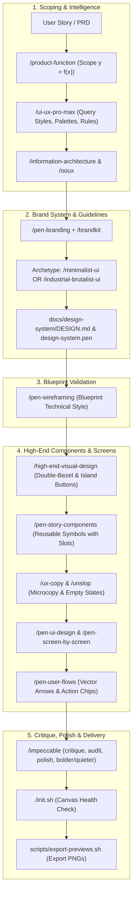

# Implementation Plan: Integrating Latest Design Skills into Pen Dev Workflow

Enhance the Pen Dev design boilerplate by incorporating elite visual design, design intelligence, aesthetic archetypes, and UX critique skills recently added to the ecosystem (`ui-ux-pro-max`, `high-end-visual-design`, `impeccable`, `brandkit`, `minimalist-ui`, `industrial-brutalist-ui`, `ux-copy`, `design-taste-frontend`), and push the enhancements to the GitHub template repository (`cesarchavezcal/pen-dev-designer`).

---

## 1. Goal Description

Elevate the design quality produced on the Pen Dev canvas from standard wireframes and screens to **Awwwards-tier, production-grade craft**. We will integrate:
1. **Design Intelligence Database (`ui-ux-pro-max`)**: 84 styles, 192 color palettes, 74 font pairings, 98 UX guidelines, and touch target rules (min 44×44px).
2. **Anti-Slop Agency Aesthetics (`high-end-visual-design`)**: Double-bezel hardware enclosures, island button architecture, creative variance engine (Ethereal Glass, Editorial Luxury, Soft Structuralism), and banned AI cliches.
3. **Dedicated Review & Refinement Levers (`impeccable`)**: `/critique`, `/audit`, `/bolder`, `/quieter`, `/harden`, and `/polish` subcommands.
4. **Studio-Grade Branding Decks (`brandkit`)**: High-end brand guidelines boards, logo construction grids, and sparse typography systems.
5. **Aesthetic Style Presets (`minimalist-ui`, `industrial-brutalist-ui`)**: Immediate plug-and-play visual worlds for different product domains.
6. **Sharp UX Microcopy (`ux-copy`, `unslop`)**: Intentional copy for CTAs, toasts, error recovery, and empty states.

---

## 2. Updated Outside-In Design Pipeline



---

## 3. Concrete Changes to Apply

### Component A: Agent Governance & Invariants
#### [MODIFY] `AGENTS.md`
- **Integrate High-End Visual Design Invariants**: Add rules against generic AI styling (no flat 1px gray borders, no repetitive cards, double-bezel nested architecture for cards, and island button architecture).
- **Integrate UI/UX Pro Max Rules**: Add touch target requirements (minimum 44x44px for interactive mobile nodes), typography hierarchy rules, and contrast checks.
- **Add Impeccable Critique Phase**: Insert an explicit `/impeccable` audit & polish step in Phase 7 before preview export.

### Component B: Skills Catalog & Documentation
#### [MODIFY] `SKILLS.md`
- Index all newly available skills categorized by role:
  - **Design Intelligence**: `ui-ux-pro-max`
  - **Agency Aesthetic Standards**: `high-end-visual-design`, `design-taste-frontend`
  - **Visual World Archetypes**: `minimalist-ui`, `industrial-brutalist-ui`
  - **Brand Direction**: `brandkit`
  - **Review & Refinement**: `impeccable`
  - **UX Microcopy**: `ux-copy`
#### [MODIFY] `README.md`
- Update pipeline diagram, feature highlights, and skill tables to reflect the enhanced workflow.
#### [MODIFY] `.atl/skill-registry.md`
- Update full index of all 45+ workspace and ecosystem skills.

### Component C: Design System Baseline Specs
#### [MODIFY] `docs/design-system/DESIGN.md`
- Add double-bezel container specifications, nested island button metrics, and references to the 84 styles from `ui-ux-pro-max`.

### Component D: Git & GitHub Sync
- Stage and commit with conventional commits: `feat(skills): integrate latest design intelligence and aesthetic skills`.
- Push to GitHub `origin main` on `cesarchavezcal/pen-dev-designer`.

---

## 4. Verification Plan

### Automated Verification
```bash
# 1. Run environment verification
./init.sh

# 2. Check skill registry consistency
grep -E "(ui-ux-pro-max|high-end-visual-design|impeccable|brandkit)" SKILLS.md
grep -E "(ui-ux-pro-max|high-end-visual-design|impeccable|brandkit)" .atl/skill-registry.md

# 3. Check git status and remote sync
git status
git log -1 --oneline
```

### Manual Verification
1. Verify `AGENTS.md` contains clear directives for double-bezel cards, island buttons, and the `/impeccable` critique pass.
2. Verify remote repository on GitHub reflects the latest commit.
