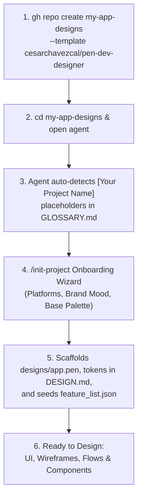

# Implementation Plan: Pen Dev Design Agent Boilerplate

Transform the code-centric `agent-boilerplate` into a specialized, high-velocity **Design Agent Template Repository** purpose-built for **Pen Dev (`pen.dev`)**, and publish it as its own public GitHub template repository under `cesarchavezcal/pen-dev-designer`.

---

## 1. Goal & Scope Overview

1. **Workspace Implementation**: Build out the complete design agent template inside `/Users/cesaradalbertochavezcalderon/Personal/pen-dev-designer`.
2. **Cruft Stripping**: Exclude all code/TDD engineering scaffolding (test runners, AST linters, code-only skills).
3. **Pen Dev Canvas Governance**: Establish native Pen Dev canvas layout rules, theme token structures, and reusable component practices in `AGENTS.md`.
4. **Skills Integration**: Install and configure the 9 dedicated design skills alongside the 21 retained discovery and thinking skills.
5. **Automation & Verification**: Provide `init.sh`, `scripts/setup-project.sh`, and `scripts/export-previews.sh`.
6. **Publish as GitHub Template**: Initialize git, create the remote `cesarchavezcal/pen-dev-designer`, push baseline, and enable GitHub template mode via `gh repo edit --template`.

---

## 2. GitHub Template Repository Architecture



### Template Foundation Files
- **`README.md`**: Badges, template clone instructions (`gh repo create --template`), architecture diagram, and agent prompts.
- **`GLOSSARY.md`**: Seeded with uninitialized placeholder tags (`[Your Design Project Name]`, `[Target Platform]`, `[Brand Archetype]`).
- **`AGENTS.md` (Section 0 - Template Detection)**: Instructs any agent to check `GLOSSARY.md` at session start; if placeholders exist, it triggers `/init-project`.
- **`.github/`**:
  - `PULL_REQUEST_TEMPLATE.md`: Standardized design review PR template with sections for canvas screen previews, user flow diagrams, and token updates.
  - `ISSUE_TEMPLATE/`: Design Story issue template and Visual Defect template.
- **`feature_list.json`**: Initialized with clean starter design milestones (Foundation Setup ➔ Design System Tokens ➔ First User Flow ➔ High-Fi Prototype).
- **`progress.md` & `session-handoff.md`**: Clean template state ready for multi-session design tracking.

---

## 3. The 9 Dedicated Pen Dev Skills

```text
.agents/skills/
├── pen-dev/                       # Core Pen Dev engine & canvas rules
├── pen-ui-design/                 # 1. High-fidelity UI screens
├── pen-user-flows/                # 2. Screen-to-screen user flows with connectors & action badges
├── pen-wireframing/               # 3. Blueprint Technical archetype wireframes
├── pen-prototyping/               # 4. Interactive states & transitions
├── pen-design-system/             # 5. Theme variables & reusable component library
├── pen-story-components/          # 6. Feature components from user stories
├── pen-screen-by-screen/          # 7. Step-by-step interaction flows
├── pen-branding/                  # 8. Brand identity, typography & palettes
└── pen-illustrations/             # 9. SVG vector artwork & decorative assets
```

---

## 4. Retained vs. Excluded Skills from `agent-boilerplate`

- **21 Retained & Integrated**: `grill-me`, `grilling`, `grill-with-docs`, `research`, `domain-modeling`, `prototype`, `writing-beats`, `writing-fragments`, `writing-shape`, `writing-for-agents`, `to-questionnaire`, `handoff`, `claude-handoff`, `ask-matt`, `wayfinder`, `wait-what`, `loop-me`, `pr`, `retro`, `product-function`, `information-architecture-review`, `ooux`, `product-description`, `unslop`, `i-have-adhd`.
- **16 Excluded (Code-Only Cruft)**: `tdd`, `implement`, `implement-spec`, `setup-ts-deep-modules`, `migrate-to-shoehorn`, `improve-codebase-architecture`, `diagnosing-bugs`, `code-review`, `setup-pre-commit`, `git-guardrails-claude-code`, `scaffold-exercises`, `setup-matt-pocock-skills`, `wizard`, `to-spec`, `to-tickets`.

---

## 5. Execution Steps

### Phase 1: Core File Structure & Markdown Foundations
- [NEW] `AGENTS.md`: Full design governance, Pen Dev canvas rules, template onboarding, and session invariants.
- [NEW] `README.md`: Public documentation and template quickstart.
- [NEW] `GLOSSARY.md`, `MEMORY.md`, `SKILLS.md`.
- [NEW] `progress.md`, `session-handoff.md`, `feature_list.json`.
- [NEW] `.cursorrules`, `CLAUDE.md`, `.gitignore`.
- [NEW] `.github/PULL_REQUEST_TEMPLATE.md`, `.github/ISSUE_TEMPLATE/design_feature.md`.

### Phase 2: Design Assets & Tokens
- [NEW] `designs/app.pen`: Starter canvas file.
- [NEW] `designs/design-system.pen`: Reusable component library.
- [NEW] `docs/design-system/DESIGN.md`: Framework-neutral design token specifications.
- [NEW] `docs/design-system/README.md`.

### Phase 3: Automation Scripts & Verification
- [NEW] `init.sh`: Pen CLI and canvas integrity check.
- [NEW] `scripts/setup-project.sh`: Interactive project onboarding wizard.
- [NEW] `scripts/export-previews.sh`: High-res PNG/PDF preview exporter.

### Phase 4: Skills Library Assembly
- [NEW] `.agents/skills/pen-dev/` (Core engine from Pen.app).
- [NEW] `.agents/skills/pen-ui-design/`.
- [NEW] `.agents/skills/pen-user-flows/`.
- [NEW] `.agents/skills/pen-wireframing/`.
- [NEW] `.agents/skills/pen-prototyping/`.
- [NEW] `.agents/skills/pen-design-system/`.
- [NEW] `.agents/skills/pen-story-components/`.
- [NEW] `.agents/skills/pen-screen-by-screen/`.
- [NEW] `.agents/skills/pen-branding/`.
- [NEW] `.agents/skills/pen-illustrations/`.
- [NEW] Copy retained discovery skills (`product-function`, `ia`, `ooux`, `product-description`, `grilling`, `unslop`, `i-have-adhd`, `research`, `prototype`, etc.) from `/tmp/agent-boilerplate-ref`.
- [NEW] `.atl/skill-registry.md`.

### Phase 5: Verification & Publishing Remote Template
1. Run `./init.sh` to confirm environment integrity.
2. Configure git author (`cesarchavezcal`) and commit baseline (`chore(setup): initialize pen-dev-designer template repository`).
3. Create GitHub repository via `gh repo create cesarchavezcal/pen-dev-designer --public --source=. --remote=origin --push`.
4. Enable GitHub template property via `gh repo edit cesarchavezcal/pen-dev-designer --template`.
5. Verify remote repository URL and template status on GitHub.
